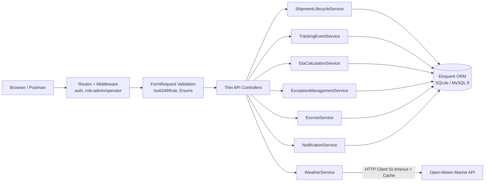

# Meridian (CargoTrace) — System Architecture

## 1. Layered Request Lifecycle

## 2. Responsibility Boundaries

- **Presentation Layer (`resources/views`, `public/assets/js`)**:
  - Role-separated cosmic glassmorphism workspaces (`/admin`, `/operator`, `/shipper`, `/buyer`, `/track`).
  - Unified **MapLibre GL JS v5** 3D Earth Globe with Esri World Imagery + OpenStreetMap layers.
- **Transport & Validation Layer (`app/Http`)**:
  - `RoleMiddleware` enforces server-side RBAC (`401` unauthenticated, `403` insufficient role).
  - `ShipmentController` enforces server-side customer data scoping (`customer_id` / `buyer_id`).
  - `FormRequest` classes isolate input validation (`Iso6346Rule` check-digit verification).
- **Business Service Layer (`app/Services`)**:
  - Encapsulates transactional integrity (`DB::transaction()`), state-machine guards, deterministic delay formulas, simulated escrow lock/release, and audit logging.
- **External Integrations**:
  - **Open-Meteo API**: Real-time marine weather per port coordinates, cached for 10 minutes with a resilient fallback estimator if offline/timeout.
