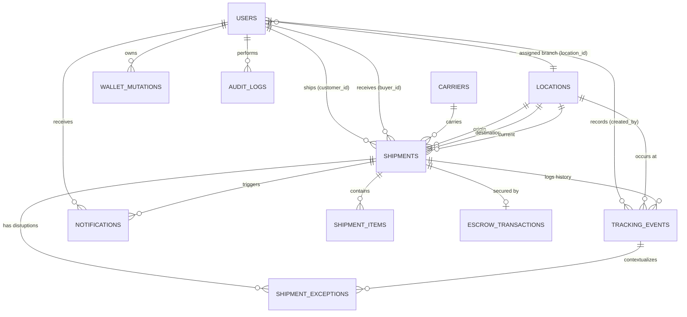

# Meridian (CargoTrace) — Entity Relationship Diagram & Data Dictionary

## 1. Entity Relationship Diagram (Mermaid)

---

## 2. Design & Cardinality Rationale

1. **`Shipment` $\rightarrow$ `TrackingEvent` (`1:N` / `hasMany`)**: Tracking events are immutable historical logs; adding a checkpoint appends a new row rather than overwriting the previous location or status.
2. **`Shipment` $\rightarrow$ `ShipmentItem` (`1:N` / `hasMany`)**: One container shipment can hold multiple cargo line items with individual quantities, weights, and conditions.
3. **`Shipment` $\rightarrow$ `ShipmentException` (`1:N` / `hasMany`)**: Multiple disruptions (e.g., `CUSTOMS_HOLD` + `WEATHER_DELAY`) can affect one voyage; `EtaCalculationService` sums `impact_hours` of all unresolved exceptions (`OPEN`, `INVESTIGATING`).
4. **`Shipment` $\rightarrow$ `EscrowTransaction` (`1:1` / `hasOne`)**: Each commercial shipment has at most one deterministic escrow contract (`shipment_id` unique FK) protecting Buyer funds until `DELIVERED`.
5. **`User` $\rightarrow$ `Location` (`N:1` / `belongsTo`)**: Optional `location_id` allows Administrators to assign Operators to specific branch ports (e.g., `IDTPR` vs `NLRTM`).

---

## 3. Data Dictionary (11 Core Tables)

| Table | Purpose | Key Columns & Constraints |
| :--- | :--- | :--- |
| `users` | Accounts, RBAC roles, branch & wallet | `id` PK, `email` UNIQUE, `role` (`admin\|operator\|customer\|surveyor`), `location_id` FK, `wallet_balance_usd` |
| `carriers` | Third-party ocean/air carriers | `id` PK, `code` UNIQUE, `name`, `transport_mode`, `is_active` |
| `locations` | UN/LOCODE ports & hubs | `id` PK, `code` UNIQUE, `name`, `type`, `country`, `latitude`, `longitude` |
| `shipments` | Master cargo shipments & ETA state | `id` PK, `tracking_number` UNIQUE, `container_number`, `customer_id` FK, `buyer_id` FK, `carrier_id` FK, `origin_location_id` FK, `destination_location_id` FK, `current_location_id` FK, `status` INDEX, `is_delayed` INDEX, `delay_hours` |
| `shipment_items` | Detailed cargo line items | `id` PK, `shipment_id` FK cascade, `item_name`, `category`, `quantity`, `weight_kg`, `condition` |
| `tracking_events` | Append-only voyage checkpoints | `id` PK, `shipment_id` FK cascade, `location_id` FK, `latitude`, `longitude`, `event_type`, `event_time` INDEX, `created_by` FK |
| `shipment_exceptions` | Delays, holds & damage records | `id` PK, `shipment_id` FK cascade, `tracking_event_id` FK, `exception_type`, `severity`, `impact_hours`, `status` (`OPEN\|INVESTIGATING\|RESOLVED`), `detected_at`, `resolved_at` |
| `escrow_transactions` | Simulated buyer-shipper escrow | `id` PK, `shipment_id` UNIQUE FK, `shipper_id` FK, `buyer_id` FK, `amount_usd`, `status` INDEX, `deposited_at`, `released_at` |
| `wallet_mutations` | Virtual wallet ledger | `id` PK, `user_id` FK, `shipment_id` FK, `type`, `amount_usd`, `balance_after_usd`, `reference_code` UNIQUE |
| `notifications` | In-app user notifications | `id` PK, `user_id` FK cascade, `shipment_id` FK, `type`, `title`, `message`, `is_read` INDEX |
| `audit_logs` | Security & compliance audit trail | `id` PK, `user_id` FK, `action`, `model_type`, `model_id`, `old_values` JSON, `new_values` JSON, `ip_address` |
