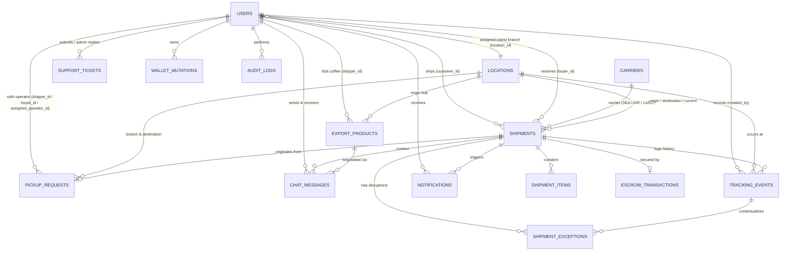

# Meridian (CargoTrace) — Entity Relationship Diagram & Data Dictionary

## 1. Entity Relationship Diagram (Mermaid)

---

## 2. Design & Cardinality Rationale

1. **`Shipment` → `TrackingEvent` (`1:N` / `hasMany`)**: Tracking events are immutable historical logs; adding a checkpoint appends a new row with historical coordinates rather than overwriting previous states.
2. **`Shipment` → `ShipmentItem` (`1:N` / `hasMany`)**: One shipment can carry multiple verified cargo items with quantities, weights, and physical inspection conditions.
3. **`Shipment` → `ShipmentException` (`1:N` / `hasMany`)**: Multiple disruptions (`CUSTOMS_HOLD`, `WEATHER_DELAY`, etc.) can affect one voyage; `EtaCalculationService` sums `impact_hours` of all unresolved exceptions (`OPEN`, `INVESTIGATING`).
4. **`Shipment` → `EscrowTransaction` (`1:1` / `hasOne`)**: Each commercial shipment has at most one deterministic escrow contract (`shipment_id` unique FK) protecting Buyer funds until `DELIVERED`.
5. **`User` → `Location` (`N:1` / `belongsTo`)**: Optional `location_id` binds Operators to specific Indonesian island branches (`Sumatra`, `Jawa`, `Kalimantan`, `Sulawesi`, `Papua`) or global hubs.
6. **`User` → `ExportProduct` (`1:N` / `hasMany`)**: Non-marketplace Nusantara coffee directory (`export_products` has **no price column**); Buyers inspect verified Shipper profiles and negotiate directly in `chat_messages`.
7. **`PickupRequest` → `Shipment` (`1:1` / nullable FK)**: Enforces anti-fraud separation: Shipper submits a `pickup_request` to summon the Branch Operator's internal land fleet; only after physical inspection does the Operator convert it into an official `shipment`.

---

## 3. Data Dictionary (15 Core Tables)

| Table | Purpose | Key Columns & Constraints |
| :--- | :--- | :--- |
| `users` | Accounts, RBAC roles, verified identity, branch & wallet | `id` PK, `email` UNIQUE, `role` (`admin\|operator\|customer\|surveyor`), `location_id` FK, `phone`, `company_name`, `address`, `city`, `country`, `identity_number`, `bio`, `is_verified`, `verified_at`, `wallet_balance_usd` |
| `carriers` | Sea, air & internal branch land fleet | `id` PK, `code` UNIQUE, `name`, `transport_mode` (`SEA\|AIR\|LAND`), `is_active` |
| `locations` | 5-island Indonesian ports/airports & global hubs | `id` PK, `code` UNIQUE, `name`, `type` (`PORT\|AIRPORT\|WAREHOUSE\|HUB`), `island`, `country`, `latitude`, `longitude` |
| `shipments` | Master cargo shipments, multimodal verification, release docs & ETA | `id` PK, `tracking_number` UNIQUE, `container_number`, `customer_id` FK, `buyer_id` FK, `carrier_id` FK, `origin_location_id` FK, `destination_location_id` FK, `current_location_id` FK, `transport_mode`, `pickup_address`, `pickup_latitude`, `pickup_longitude`, `seal_number`, `verification_checklist` JSON, `release_document_number`, `release_document_type`, `release_courier_tracking`, `release_issued_at`, `simulated_days_elapsed`, `status` INDEX, `is_delayed` INDEX, `delay_hours` |
| `shipment_items` | Detailed verified cargo line items | `id` PK, `shipment_id` FK cascade, `item_name`, `category`, `quantity`, `weight_kg`, `condition` |
| `tracking_events` | Append-only voyage checkpoints | `id` PK, `shipment_id` FK cascade, `location_id` FK, `latitude`, `longitude`, `event_type`, `event_time` INDEX, `created_by` FK |
| `shipment_exceptions` | Delays, holds & damage records | `id` PK, `shipment_id` FK cascade, `tracking_event_id` FK, `exception_type`, `severity`, `impact_hours`, `status` (`OPEN\|INVESTIGATING\|RESOLVED`), `detected_at`, `resolved_at` |
| `escrow_transactions` | Simulated buyer–shipper escrow (*Rekening Jaminan*) | `id` PK, `shipment_id` UNIQUE FK, `shipper_id` FK, `buyer_id` FK, `amount_usd`, `status` INDEX, `deposited_at`, `released_at` |
| `wallet_mutations` | Virtual wallet ledger | `id` PK, `user_id` FK, `shipment_id` FK, `type`, `amount_usd`, `balance_after_usd`, `reference_code` UNIQUE |
| `notifications` | In-app user notifications | `id` PK, `user_id` FK cascade, `shipment_id` FK, `type`, `title`, `message`, `is_read` INDEX |
| `audit_logs` | Security & compliance audit trail | `id` PK, `user_id` FK, `action`, `model_type`, `model_id`, `old_values` JSON, `new_values` JSON, `ip_address` |
| `export_products` | Non-marketplace Nusantara coffee directory (no prices) | `id` PK, `shipper_id` FK cascade, `origin_location_id` FK, `name`, `island` INDEX, `region`, `bean_type`, `process_method`, `altitude_mdpl`, `tasting_notes`, `supply_capacity`, `is_active` |
| `pickup_requests` | Shipper calls to summon Branch Operator for physical check | `id` PK, `request_code` UNIQUE, `shipper_id` FK, `buyer_id` FK, `branch_location_id` FK, `destination_location_id` FK, `assigned_operator_id` FK, `shipment_id` FK, `pickup_city`, `pickup_address`, `pickup_latitude`, `pickup_longitude`, `target_days`, `preferred_mode` (`SEA\|AIR`), `agreed_escrow_usd`, `commodity_summary`, `status` INDEX |
| `chat_messages` | Direct negotiation & coordination chat (`Buyer ↔ Shipper ↔ Operator`) | `id` PK, `channel_type` (`DIRECT\|SHIPMENT\|PICKUP_REQUEST`), `shipment_id` FK, `pickup_request_id` FK, `export_product_id` FK, `sender_id` FK, `recipient_id` FK, `message`, `is_read` INDEX |
| `support_tickets` | Public & user **Bantuan Admin** support inbox | `id` PK, `ticket_code` UNIQUE, `user_id` FK, `guest_name`, `guest_contact`, `user_role`, `category`, `subject`, `message`, `status` INDEX, `admin_reply`, `replied_by` FK, `replied_at` |
